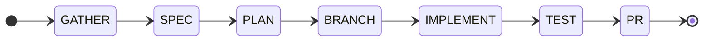

# spring-boot-workflows

[](VERSION)

**Spring Boot development workflows for Claude Code — structured feature delivery, proportional quality gates, multi-session state, and Spring-specific rules.**

`spring-boot-workflows` is the **claude-workflows** orchestration engine specialized for
Java/Spring projects. It keeps the workflow engine intact — 24 phase-driven skills, 18
orchestration rules, persistent state, proportional review gates — and replaces the
multi-language asset set with a Spring Boot one: Java coding rules, Spring Boot coding
rules, Spring-specific review checklists, and 27 vendored Spring Boot domain skills
covering JPA, REST, security, migrations, transactions, and testing.

---

## Installation

```bash
# Step 1: Add the marketplace
/plugin marketplace add chinaares/spring-boot-workflows

# Step 2: Install the plugin
/plugin install spring-boot-workflows
```

Installing the plugin also pulls in **`spring-boot-template`** (piomin) as a runtime
dependency — Claude Code resolves and installs it automatically, then reclaims it with
`claude plugin prune` when you uninstall.

During installation you will be prompted to configure:

| Setting | Options | Default |
|---------|---------|---------|
| `project_type` | `spring-boot`, `java`, `generic` | `spring-boot` |
| `team` | `spring`, `none` | `none` |
| `git_main_branch` | Any branch name | `main` |
| `git_dev_branch` | Any branch name | `develop` |
| `commit_format` | `conventional`, `angular`, `simple` | `conventional` |

To change settings later:

```
claude plugin configure spring-boot-workflows
```

> **Repository**: [github.com/chinaares/spring-boot-workflows](https://github.com/chinaares/spring-boot-workflows)

---

## Getting Started

### 1. Initialize the project

```
/spring-boot-workflows:setup
```

Detects the build system (Maven/Gradle, wrapper-first), the **Spring Boot major version**,
and the persistence stack; then writes `.workflows/config.yml`.

### 2. Start a workflow

```
/spring-boot-workflows:start
```

---

## Skills

All skills are namespaced under `spring-boot-workflows`.

### Workflow skills (24)

| Skill | Command | Description |
|-------|---------|-------------|
| New Feature | `/spring-boot-workflows:new-feature` | Full workflow: spec, brainstorm, plan, implement, test, PR |
| Extend Feature | `/spring-boot-workflows:extend-feature` | Add to an existing feature with backward compatibility |
| New Project | `/spring-boot-workflows:new-project` | Bootstrap and scaffold a new project |
| Hotfix | `/spring-boot-workflows:hotfix` | Emergency production fix with regression testing |
| CI Fix | `/spring-boot-workflows:ci-fix` | Diagnose and fix failing CI/CD pipelines |
| CI Setup | `/spring-boot-workflows:ci-setup` | Generate GitHub/Gitea Actions workflows (Maven, tests, coverage, artifacts) |
| Diagnose | `/spring-boot-workflows:diagnose` | Systematic bug investigation via hypothesis testing |
| Migrate | `/spring-boot-workflows:migrate` | Upgrade dependencies, APIs, or patterns |
| Refactor | `/spring-boot-workflows:refactor` | Safely restructure code with behavioral contracts |
| Release | `/spring-boot-workflows:release` | Version bump, changelog, tag, release PR |
| Review | `/spring-boot-workflows:review` | Systematic PR code review |
| Brainstorm | `/spring-boot-workflows:brainstorm` | 5 structured brainstorming techniques |
| Scope | `/spring-boot-workflows:scope` | Analyze task complexity before choosing a workflow |
| Test | `/spring-boot-workflows:test` | Generate tests with coverage analysis |
| Retrospective | `/spring-boot-workflows:retrospective` | Analyze workflow history for improvements |
| Learn | `/spring-boot-workflows:learn` | Capture and reuse workflow patterns |
| Metrics | `/spring-boot-workflows:metrics` | Workflow execution analytics |
| Setup | `/spring-boot-workflows:setup` | Initialize project for workflows |
| Start | `/spring-boot-workflows:start` | Interactive workflow menu |
| Resume | `/spring-boot-workflows:resume` | Resume paused or interrupted workflows |
| Git Flow | `/spring-boot-workflows:git-flow` | Git branching, commit, PR, merge operations |
| Guards | `/spring-boot-workflows:guards` | Safety and quality guard enforcement |
| Template | `/spring-boot-workflows:template` | Save and reuse workflow templates |
| Compose Skill | `/spring-boot-workflows:compose-skill` | Create custom workflow skills |

### Spring Boot domain skills (27 — 19 topics, Boot 4 and Boot 3 variants)

Vendored under `skills/spring-boot-4/` and `skills/spring-boot-3/`. They are loaded
**on demand** by the router, not dumped into every session.

| Topic | Boot 4 | Boot 3 | Covers |
|---|---|---|---|
| JPA | `spring-data-jpa` | `spring-data-jpa-boot3` | Entities, repositories, queries, projections, N+1, batch writes |
| REST | `rest-api-conventions` | `rest-api-conventions-boot3` | Controllers, DTOs, pagination, validation, status codes |
| Problem Details | `problem-details-rfc9457` | — | RFC 9457 error model, field errors, status mapping |
| Security — self-issued tokens | `spring-security-jwt` | `spring-security-jwt-boot3` | JWT encoding/decoding, filters, method security |
| Security — external IdP | `oauth2-resource-server` | `oauth2-resource-server-boot3` | Resource-server config, issuer/JWK, claim mapping |
| Transactions | `transactional-patterns` | — | Propagation, read-only, optimistic locking, after-commit events |
| Migrations | `flyway-migrations` | `flyway-migrations-boot3` | Immutable migrations, `ddl-auto: validate`, backfills |
| Testing | `testing-pyramid` | `testing-pyramid-boot3` | Slice tests, Testcontainers, mocking boundaries |
| Configuration | `configuration-properties` | `configuration-properties-boot3` | Type-safe binding, profiles, validation |
| Architecture | `layered-architecture` | — | Layer rules, dependency direction |
| Modular monolith | `spring-modulith` | — | `@ApplicationModule`, module boundaries, verification |
| Multi-module build | `multi-module-maven` | `multi-module-maven-boot3` | Parent/BOM layout, module boundaries, build order |
| Architecture review | `spring-code-review` | — | DDD, value objects, modularity, Java 25, performance, security |
| Scaffolding | `spring-project-scaffolding` | — | New project/module structure, Boot 4 features |
| Boot 4 migration | `spring-boot-migration` | — | Boot 3 → 4, Modulith 2, Testcontainers 2, Jackson 3 |
| API versioning | `api-versioning` | — | URL/header/media-type versioning |
| Idempotency | `idempotency-patterns` | — | Safe retries on write endpoints |
| Null safety | `null-safety` | — | JSpecify `@NullMarked`, nullability annotations |
| Caching | `spring-data-redis` | — | Redis patterns, cache invalidation |

### Router

`spring-context` decides which of the above a change needs. It runs before implementation
and before the review check phase, and produces an explicit routing decision — including a
**"Not loaded (and why)"** list — so the knowledge set stays minimal and auditable.

---

## Spring Boot Knowledge Layer

### Version trees

`project.spring.boot_major` (`3` or `4`) in `.workflows/config.yml` selects the tree.
It is detected from the build file (Rule 4) and **never guessed** — Boot 3 and Boot 4
differ in package locations (`com.fasterxml.jackson.*` vs `tools.jackson.*`), test
annotations (`@MockBean` vs `@MockitoBean`), and starter names
(`spring-boot-starter-web` vs `spring-boot-starter-webmvc`).

```yaml
project:
  type: "spring-boot"
  language: "java"
  spring:
    boot_major: 4
    build_tool: "maven"      # maven | gradle
    persistence: "jpa"       # jpa | jdbc
```

### Deterministic migration scanner

`scripts/scan_migration_issues.py` (858 lines) scans a project for Boot 4 / Modulith 2 /
Testcontainers 2 migration issues and reports `CRITICAL` / `WARNING` / `INFO` with
`file:line` and a suggested fix.

```bash
python3 <plugin-root>/scripts/scan_migration_issues.py /path/to/project
```

Run it first in `/migrate` and `/diagnose` — deterministic evidence before model inference.

---

## Configuration

### Four-tier config (priority order)

1. **CLI flags** — per-invocation overrides (e.g. `--skip-brainstorm`)
2. **`.workflows/config.yml`** — project-level overrides
3. **Plugin userConfig** — values set during `claude plugin install`
4. **Built-in defaults** — `config/defaults.yml` in the plugin

### What `.workflows/config.yml` controls

- **Git flow**: branch naming patterns, commit format, PR settings, merge strategy
- **Workflow behavior**: require/skip brainstorm, tests, spec; plan phase limits
- **Quality gates**: proportional review scaling, checklist selection
- **Spring**: `project.spring.boot_major`, `build_tool`, `persistence`
- **Telemetry**: opt-in execution metrics
- **Skill aliases**: custom command shortcuts
- **Chains**: automatic workflow sequencing

---

## Quality Gates

**Before writing code** — Spring-specific rules are loaded from `rules/`:

| File | Contents |
|------|----------|
| `rules/java.md` | Language level, records, null safety, exceptions, concurrency, visibility & naming matrices, modern Java |
| `rules/spring-boot.md` | DI, controllers & DTOs, Problem Details, JPA, transactions, Flyway, configuration, HTTP clients, security, testing, observability, Boot 4 specifics |

**Before creating a PR** — proportional review gates scale to change size:

| Change Size | Gate Level |
|-------------|-----------|
| 1-3 files, ≤50 lines | **Light**: Critical security checks only |
| 4-15 files | **Standard**: General + Spring checklists (High/Critical) |
| More than 15 files | **Full**: All checklists, all severity levels |

All Critical/High severity items must pass before the PR is created, each with explicit
evidence (`PASS:` / `FAIL:` / `N/A:`).

---

## Visual Progress

Workflows display a Mermaid state diagram that updates after every phase transition.



Stored in `.workflows/current-state.md`. Disable with `progress.visual: false`.

---

## State & Persistence

### Project-level (`.workflows/`)

| File | Purpose |
|------|---------|
| `current-state.md` | Active workflow state (YAML frontmatter + phase history + decisions) |
| `paused-*.md` | Paused workflows |
| `<feature>/` | Per-workflow output directory (specs, plans, phase outputs) |
| `history/` | Completed workflow archives |
| `learned/` | Captured patterns from `/spring-boot-workflows:learn` |
| `config.yml` | Project configuration |
| `telemetry.jsonl` | Per-phase metrics (opt-in) |
| `knowledge.jsonl` | Extracted decisions for future brainstorms |

### Session hooks

- **SessionStart**: detects active/paused workflows and prompts to resume
- **PreToolUse**: warns if a quality gate was not run before PR creation
- **PostToolUse**: enforces phase-state updates after every write under `.workflows/`

---

## Teams

| Team | Focus | Extra rules |
|------|-------|-------------|
| `spring` | Spring Boot layering, JPA, error model, test strategy | `teams/spring/rules/team-conventions.md` |

Set the team during plugin install or via `claude plugin configure spring-boot-workflows`.

---

## Orchestration Rules

All workflows follow 18 centralized orchestration rules:

- **Path resolution**: deterministic `<plugin-root>` convention
- **State management**: initialize, update, archive workflow state
- **Phase protocol**: write output files after every phase
- **Quality gates**: proportional — scales review intensity to change size
- **Build detection**: wrapper-first Maven/Gradle detection + Spring Boot major version
- **Error recovery**: REPLAN protocol after 3+ build failures
- **Telemetry**: optional per-phase metrics
- **Knowledge extraction**: capture decisions for future brainstorms
- **Visual progress**: Mermaid state diagrams

Rules live in `skills/_orchestration/RULES.md`.

---

## Development & Testing

### Local plugin testing

```bash
claude --plugin-dir /path/to/spring-boot-workflows
```

### Validation

```bash
claude plugin validate . --strict   # manifest, skills, agents, commands
node tests/validate-workflows.js     # workflow structure, rules, state protocol
node tests/ci-templates.test.js      # CI template render + YAML/XML parse
```

### Reload after changes

```
/reload-plugins
```

---

## Third-Party Notices

Bundled and depended-upon third-party content, with licenses and the exact local
modifications, is documented in **[THIRD_PARTY_NOTICES.md](THIRD_PARTY_NOTICES.md)**.

---

## License

MIT. Derived from [claude-workflows](https://github.com/ragaa07/claude-workflows) (MIT,
© ragaa07).
