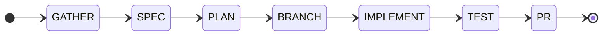

# spring-boot-workflows

[](VERSION)

**面向 Claude Code 的 Spring Boot 开发工作流 —— 结构化的功能交付、按比例伸缩的质量门禁、跨会话状态保持，以及 Spring 专用规则。**

`spring-boot-workflows` 是 **claude-workflows** 编排引擎针对 Java/Spring 项目的特化版本。
它完整保留了工作流引擎 —— 24 个阶段驱动的技能、18 条编排规则、持久化状态、按比例
伸缩的评审门禁 —— 只把多语言资产集替换为 Spring Boot 版本：Java 编码规则、Spring Boot
编码规则、Spring 专用评审清单，以及 27 个内置的 Spring Boot 领域技能，覆盖 JPA、REST、
安全、数据库迁移、事务与测试。

---

## 安装

```bash
# 第 1 步：添加 marketplace
/plugin marketplace add chinaares/spring-boot-workflows

# 第 2 步：安装插件
/plugin install spring-boot-workflows
```

安装本插件的同时会作为一个运行时依赖拉入 **`spring-boot-template`**（piomin）。Claude Code
会自动解析并安装它；当你卸载本插件时，可用 `claude plugin prune` 将其回收清理。

安装过程中会提示你配置以下选项：

| 配置项 | 可选值 | 默认值 |
|---------|---------|---------|
| `project_type` | `spring-boot`、`java`、`generic` | `spring-boot` |
| `team` | `spring`、`none` | `none` |
| `git_main_branch` | 任意分支名 | `main` |
| `git_dev_branch` | 任意分支名 | `develop` |
| `commit_format` | `conventional`、`angular`、`simple` | `conventional` |

日后如需修改配置：

```
claude plugin configure spring-boot-workflows
```

> **代码仓库**：[github.com/chinaares/spring-boot-workflows](https://github.com/chinaares/spring-boot-workflows)

---

## 快速上手

### 1. 初始化项目

```
/spring-boot-workflows:setup
```

检测构建系统（优先使用 wrapper，支持 Maven/Gradle）、**Spring Boot 主版本**以及持久化
技术栈，然后写入 `.workflows/config.yml`。

### 2. 启动工作流

```
/spring-boot-workflows:start
```

---

## 技能

所有技能的命名空间均为 `spring-boot-workflows`。

### 工作流技能（24 个）

| 技能 | 命令 | 说明 |
|-------|---------|-------------|
| 新功能 | `/spring-boot-workflows:new-feature` | 完整工作流：规格、头脑风暴、计划、实现、测试、PR |
| 扩展功能 | `/spring-boot-workflows:extend-feature` | 在保持向后兼容的前提下为既有功能追加能力 |
| 新项目 | `/spring-boot-workflows:new-project` | 初始化并搭建新项目 |
| 紧急修复 | `/spring-boot-workflows:hotfix` | 带回归测试的生产环境紧急修复 |
| CI 修复 | `/spring-boot-workflows:ci-fix` | 诊断并修复失败的 CI/CD 流水线 |
| CI 生成 | `/spring-boot-workflows:ci-setup` | 生成 GitHub/Gitea Actions 工作流（Maven、测试、覆盖率、制品） |
| 诊断 | `/spring-boot-workflows:diagnose` | 通过假设验证进行系统化缺陷排查 |
| 迁移 | `/spring-boot-workflows:migrate` | 升级依赖、API 或架构模式 |
| 重构 | `/spring-boot-workflows:refactor` | 以行为契约为保障安全地重构代码 |
| 发布 | `/spring-boot-workflows:release` | 版本号递增、变更日志、打标签、发布 PR |
| 评审 | `/spring-boot-workflows:review` | 系统化的 PR 代码评审 |
| 头脑风暴 | `/spring-boot-workflows:brainstorm` | 5 种结构化的头脑风暴技法 |
| 范围评估 | `/spring-boot-workflows:scope` | 在选择工作流之前分析任务复杂度 |
| 测试 | `/spring-boot-workflows:test` | 生成测试并分析覆盖率 |
| 复盘 | `/spring-boot-workflows:retrospective` | 分析工作流历史以寻找改进点 |
| 学习 | `/spring-boot-workflows:learn` | 捕获并复用工作流模式 |
| 度量 | `/spring-boot-workflows:metrics` | 工作流执行分析 |
| 初始化 | `/spring-boot-workflows:setup` | 为工作流初始化项目 |
| 启动 | `/spring-boot-workflows:start` | 交互式工作流菜单 |
| 恢复 | `/spring-boot-workflows:resume` | 恢复已暂停或中断的工作流 |
| Git Flow | `/spring-boot-workflows:git-flow` | Git 分支、提交、PR、合并操作 |
| 守卫 | `/spring-boot-workflows:guards` | 安全与质量守卫的强制执行 |
| 模板 | `/spring-boot-workflows:template` | 保存并复用工作流模板 |
| 技能编排 | `/spring-boot-workflows:compose-skill` | 创建自定义工作流技能 |

### Spring Boot 领域技能（27 个 —— 19 个主题，含 Boot 4 与 Boot 3 两套变体）

内置于 `skills/spring-boot-4/` 与 `skills/spring-boot-3/`。它们由路由技能**按需加载**，
而非在每个会话中全量注入。

| 主题 | Boot 4 | Boot 3 | 覆盖内容 |
|---|---|---|---|
| JPA | `spring-data-jpa` | `spring-data-jpa-boot3` | 实体、仓库、查询、投影、N+1、批量写入 |
| REST | `rest-api-conventions` | `rest-api-conventions-boot3` | 控制器、DTO、分页、校验、状态码 |
| Problem Details | `problem-details-rfc9457` | — | RFC 9457 错误模型、字段错误、状态码映射 |
| 安全 —— 自签令牌 | `spring-security-jwt` | `spring-security-jwt-boot3` | JWT 编解码、过滤器、方法级安全 |
| 安全 —— 外部 IdP | `oauth2-resource-server` | `oauth2-resource-server-boot3` | 资源服务器配置、issuer/JWK、声明映射 |
| 事务 | `transactional-patterns` | — | 传播行为、只读、乐观锁、提交后事件 |
| 迁移 | `flyway-migrations` | `flyway-migrations-boot3` | 不可变迁移、`ddl-auto: validate`、数据回填 |
| 测试 | `testing-pyramid` | `testing-pyramid-boot3` | 切片测试、Testcontainers、mock 边界 |
| 配置 | `configuration-properties` | `configuration-properties-boot3` | 类型安全绑定、profile、校验 |
| 架构 | `layered-architecture` | — | 分层规则、依赖方向 |
| 模块化单体 | `spring-modulith` | — | `@ApplicationModule`、模块边界、校验 |
| 多模块构建 | `multi-module-maven` | `multi-module-maven-boot3` | 父工程/BOM 布局、模块边界、构建顺序 |
| 架构评审 | `spring-code-review` | — | DDD、值对象、模块化、Java 25、性能、安全 |
| 脚手架 | `spring-project-scaffolding` | — | 新项目/模块结构、Boot 4 特性 |
| Boot 4 迁移 | `spring-boot-migration` | — | Boot 3 → 4、Modulith 2、Testcontainers 2、Jackson 3 |
| API 版本管理 | `api-versioning` | — | URL/请求头/媒体类型三种版本化方式 |
| 幂等性 | `idempotency-patterns` | — | 写接口的安全重试 |
| 空安全 | `null-safety` | — | JSpecify `@NullMarked`、可空性注解 |
| 缓存 | `spring-data-redis` | — | Redis 模式、缓存失效 |

### 路由

`spring-context` 决定某次改动需要加载上述哪些技能。它在实现之前、以及评审检查阶段之前
运行，并输出一份明确的路由决策 —— 其中包含**「未加载（以及原因）」**清单 —— 从而让知识集
保持最小且可审计。

---

## Spring Boot 知识层

### 版本树

`.workflows/config.yml` 中的 `project.spring.boot_major`（`3` 或 `4`）用于选择版本树。
它从构建文件中检测得出（规则 4），**绝不做猜测** —— Boot 3 与 Boot 4 在包路径
（`com.fasterxml.jackson.*` 与 `tools.jackson.*`）、测试注解（`@MockBean` 与
`@MockitoBean`）以及 starter 名称（`spring-boot-starter-web` 与
`spring-boot-starter-webmvc`）上都存在差异。

```yaml
project:
  type: "spring-boot"
  language: "java"
  spring:
    boot_major: 4
    build_tool: "maven"      # maven | gradle
    persistence: "jpa"       # jpa | jdbc
```

### 确定性迁移扫描器

`scripts/scan_migration_issues.py`（858 行）扫描项目中的 Boot 4 / Modulith 2 /
Testcontainers 2 迁移问题，并按 `CRITICAL` / `WARNING` / `INFO` 分级报告，附带
`file:line` 位置与修复建议。

```bash
python3 <plugin-root>/scripts/scan_migration_issues.py /path/to/project
```

在 `/migrate` 与 `/diagnose` 中应当首先运行它 —— 先取得确定性证据，再做模型推断。

---

## 配置

### 四层配置（按优先级排序）

1. **CLI 参数** —— 单次调用的覆盖项（例如 `--skip-brainstorm`）
2. **`.workflows/config.yml`** —— 项目级覆盖
3. **插件 userConfig** —— 在 `claude plugin install` 期间设置的值
4. **内置默认值** —— 插件中的 `config/defaults.yml`

### `.workflows/config.yml` 控制的内容

- **Git 流程**：分支命名模式、提交格式、PR 设置、合并策略
- **工作流行为**：要求/跳过头脑风暴、测试、规格；计划阶段上限
- **质量门禁**：按比例伸缩的评审强度、清单选择
- **Spring**：`project.spring.boot_major`、`build_tool`、`persistence`
- **遥测**：可选的执行度量
- **技能别名**：自定义命令快捷方式
- **链式调用**：自动的工作流串联

---

## 质量门禁

**写代码之前** —— 从 `rules/` 加载 Spring 专用规则：

| 文件 | 内容 |
|------|----------|
| `rules/java.md` | 语言级别、record、空安全、异常、并发、可见性与命名矩阵、现代 Java |
| `rules/spring-boot.md` | 依赖注入、控制器与 DTO、Problem Details、JPA、事务、Flyway、配置、HTTP 客户端、安全、测试、可观测性、Boot 4 专有内容 |

**创建 PR 之前** —— 质量门禁按改动规模伸缩：

| 改动规模 | 门禁级别 |
|-------------|-----------|
| 1-3 个文件、≤50 行 | **轻量**：仅关键安全检查 |
| 4-15 个文件 | **标准**：通用 + Spring 清单（高/严重级别） |
| 超过 15 个文件 | **完整**：全部清单、全部严重级别 |

所有「严重/高」级别的条目必须在创建 PR 之前通过，且每项都要给出明确证据
（`PASS:` / `FAIL:` / `N/A:`）。

---

## 可视化进度

工作流会显示一个 Mermaid 状态图，并在每次阶段切换后更新。



状态图保存在 `.workflows/current-state.md` 中。可通过 `progress.visual: false` 关闭。

---

## 状态与持久化

### 项目级（`.workflows/`）

| 文件 | 用途 |
|------|---------|
| `current-state.md` | 当前活动工作流的状态（YAML frontmatter + 阶段历史 + 决策） |
| `paused-*.md` | 已暂停的工作流 |
| `<feature>/` | 单个工作流的输出目录（规格、计划、各阶段产物） |
| `history/` | 已完成工作流的归档 |
| `learned/` | 由 `/spring-boot-workflows:learn` 捕获的模式 |
| `config.yml` | 项目配置 |
| `telemetry.jsonl` | 各阶段度量（可选） |
| `knowledge.jsonl` | 为后续头脑风暴提取的决策 |

### 会话钩子

- **SessionStart**：检测活动/暂停的工作流，并提示恢复
- **PreToolUse**：若在创建 PR 之前未运行质量门禁，则发出警告
- **PostToolUse**：在 `.workflows/` 下的每次写入之后，强制更新阶段状态

---

## 团队

| 团队 | 关注点 | 附加规则 |
|------|-------|-------------|
| `spring` | Spring Boot 分层、JPA、错误模型、测试策略 | `teams/spring/rules/team-conventions.md` |

可在插件安装期间设置团队，或通过 `claude plugin configure spring-boot-workflows` 设置。

---

## 编排规则

所有工作流都遵循 18 条集中式编排规则：

- **路径解析**：确定性的 `<plugin-root>` 约定
- **状态管理**：初始化、更新、归档工作流状态
- **阶段协议**：每个阶段结束后写出输出文件
- **质量门禁**：按比例伸缩 —— 评审强度随改动规模调整
- **构建检测**：优先 wrapper 的 Maven/Gradle 检测 + Spring Boot 主版本
- **错误恢复**：连续 3 次以上构建失败后触发 REPLAN 协议
- **遥测**：可选的各阶段度量
- **知识提取**：为后续头脑风暴捕获决策
- **可视化进度**：Mermaid 状态图

规则位于 `skills/_orchestration/RULES.md`。

---

## 开发与测试

### 本地测试插件

```bash
claude --plugin-dir /path/to/spring-boot-workflows
```

### 校验

```bash
claude plugin validate . --strict   # 清单、技能、agent、命令
node tests/validate-workflows.js     # 工作流结构、规则、状态协议
node tests/ci-templates.test.js      # CI 模板渲染 + YAML/XML 解析
```

### 修改后重新加载

```
/reload-plugins
```

---

## 第三方声明

随附及依赖的第三方内容、其许可证以及确切的本地修改，记录在
**[THIRD_PARTY_NOTICES.md](THIRD_PARTY_NOTICES.md)**。

---

## 许可证

MIT。衍生自 [claude-workflows](https://github.com/ragaa07/claude-workflows)（MIT，
© ragaa07）。
